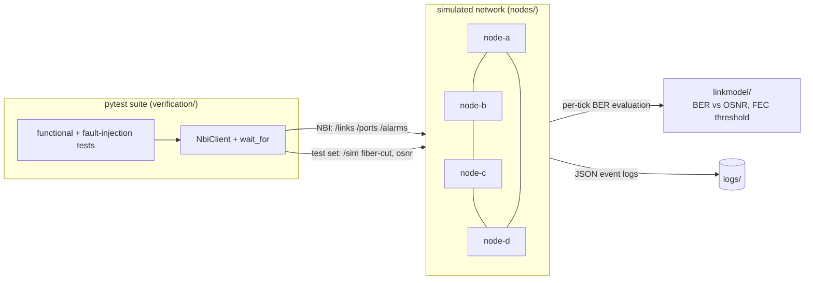
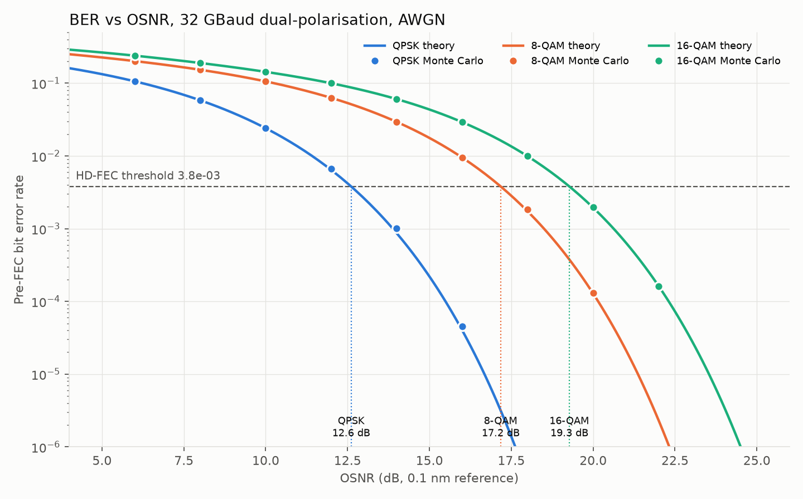
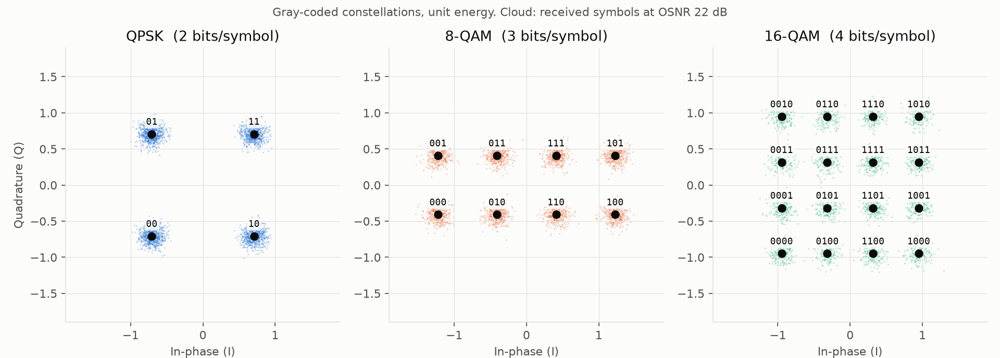

# Optical Network Verification Lab

A small simulated packet-optical network plus an automated verification
suite, built to mirror product verification work: build a test environment,
validate features, automate tests in Python, analyse logs and track defects.

## Status

| Stage | Scope | State |
|---|---|---|
| 1 | Link model: QPSK/8-QAM/16-QAM, BER vs OSNR, Monte Carlo cross-check, FEC alarm | Done |
| 2 | Four-node ring (FastAPI + Docker), REST NBI, functional and fault-injection tests | Done |
| 3 | Log parser, defect entries, test plan | Next |

## Architecture



## Quickstart

```bash
python -m venv .venv
.venv\Scripts\activate            # Linux/macOS: source .venv/bin/activate
pip install -r requirements.txt
python run.py all                 # 83 tests + HTML report (reports/) + plots (plots/)
```

The tests start the four nodes as local processes, so Docker isn't needed.
To run the same suite against containers instead:

```bash
docker compose up -d --build
NBI_URLS=node-a=http://localhost:8001,node-b=http://localhost:8002,node-c=http://localhost:8003,node-d=http://localhost:8004 python run.py test
```

To run one node by hand and explore its API at `http://localhost:8001/docs`:

```bash
python -m nodes --id node-a --http-port 8001
```

## Stage 1: link model



The lines are the exact Gray-coded BER formulas. The dots are an
independent Monte Carlo simulation over AWGN, and they land on the lines
across five decades. The dashed line is the HD-FEC threshold (3.8e-3).
Where each curve crosses it gives that format's required OSNR at 32 GBaud
dual-polarisation: **QPSK 12.6 dB, 8-QAM 17.2 dB, 16-QAM 19.3 dB**.



Details: [docs/stage1-link-model.md](docs/stage1-link-model.md)

## Stage 2: nodes and fault injection

Each node manages two line ports and re-evaluates its links on every tick:
- a fiber cut raises a critical `LOS`
- an OSNR drop raises a major `PRE_FEC_BER_EXCEEDS_THRESHOLD`, or steps
  the modulation format down when the link is set to AUTO

The suite checks four things:
- the right alarm shows on both ends within 3 s
- no stray alarms appear elsewhere
- LOS masks the secondary BER alarm
- every alarm clears after repair

Details: [docs/stage2-nodes.md](docs/stage2-nodes.md)

## Layout

```
linkmodel/      modulation, OSNR<->SNR, theory BER, Monte Carlo, FEC alarm logic
nodes/          network element: state + alarms, FastAPI NBI, JSON event log
verification/   test toolkit: NBI client, wait_for, ring topology
tests/          unit, model-verification, functional and fault-injection tests
scripts/        plot generation
docs/           design notes per stage
defects/        (stage 3) defect entries as JSON
```
